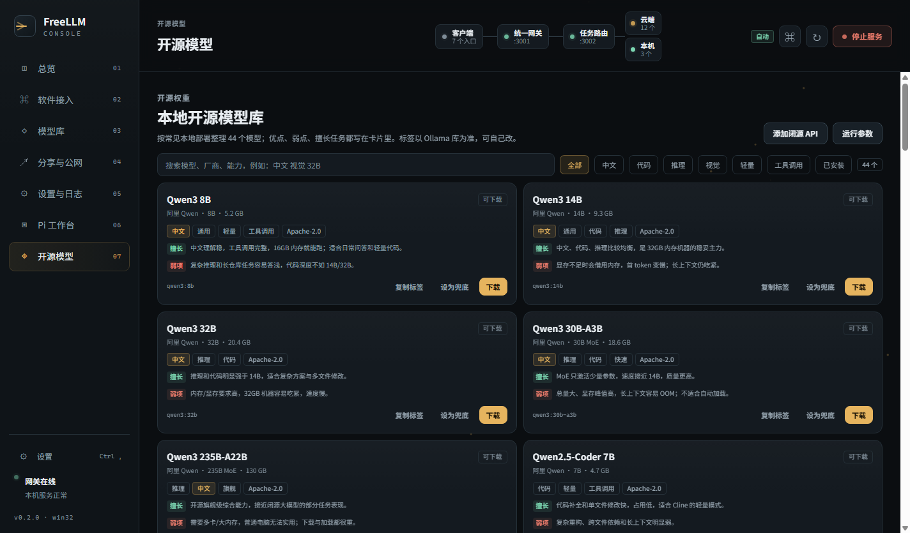
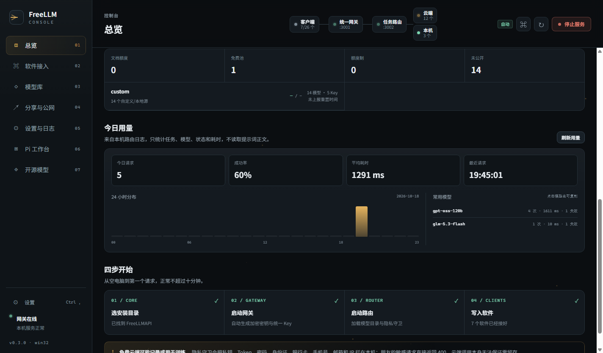
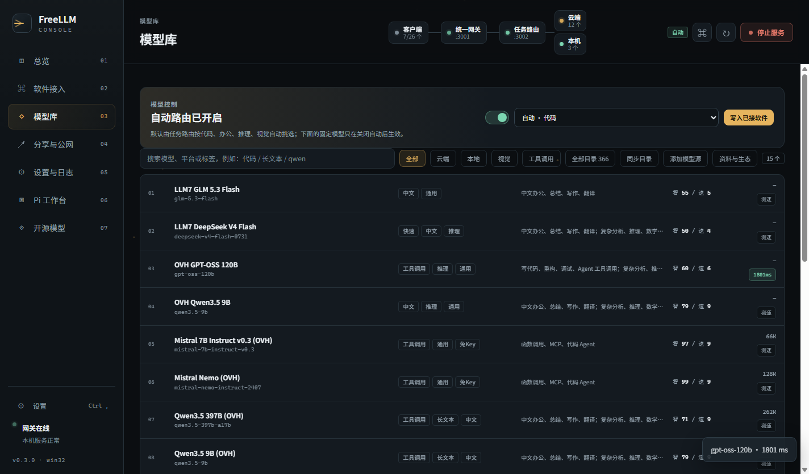
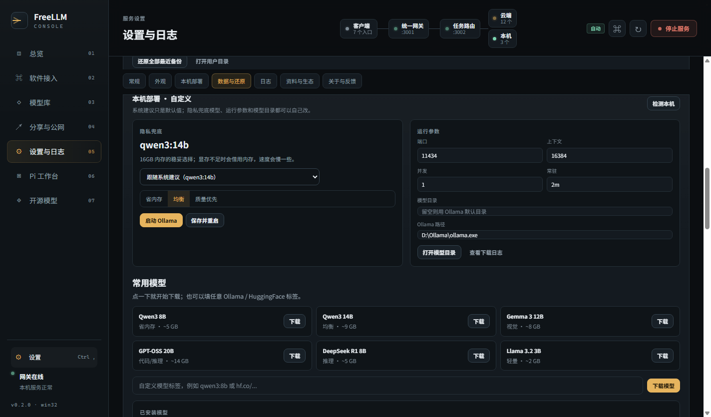
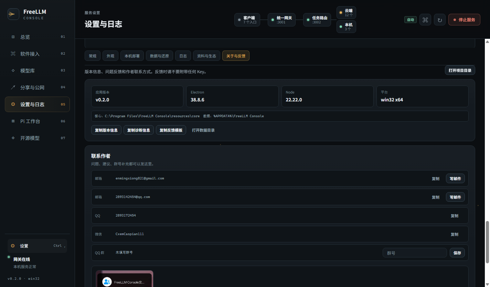
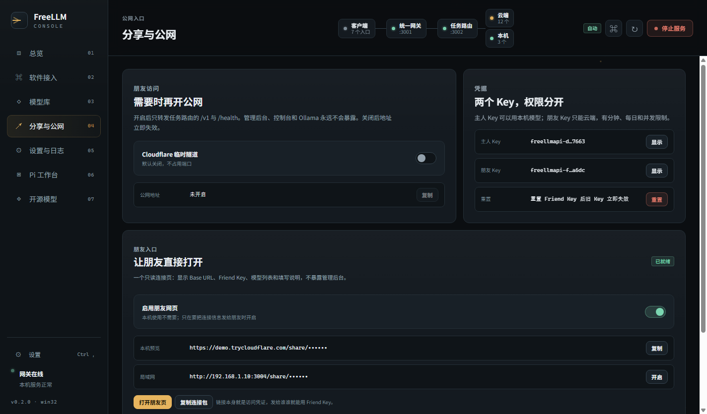
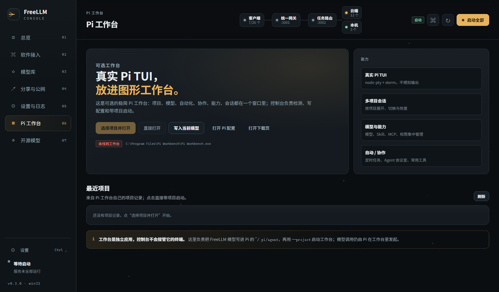

# FreeLLM Console

[](https://github.com/enmingxiong821-cloud/FreeLLM-console/actions/workflows/build.yml)

把原来的浏览器控制台做成桌面软件：开机就能用，一键启动网关与路由，一键写入 Codex / Claude Code / CC Switch / EchoBird / Continue，并把 Key、公网和日志收在同一个窗口里。

当前版本：**0.3.0**。发布包与变更记录见 [GitHub Releases](https://github.com/enmingxiong821-cloud/FreeLLM-console/releases)。


## 现在能做什么

- **原生桌面窗口**：Electron 38，Windows 10/11 已实测；macOS 与 Linux 的构建配置已提供，需在对应系统上产出并验证。
- **首启向导**：硬件检测 → 模式选择 → 安装目录 → 软件接入 → 真实请求自检。
- **服务托管**：网关、任务路由、Ollama 的启动/停止/状态/日志都在应用内完成。
- **26 个常用入口**：Codex、Claude Code、Pi、Pi 工作台、PI-Desktop、Gemini CLI、CC Switch、EchoBird、Continue、Cline、Cherry Studio、Aider、Cursor、Windsurf、Zed、Roo Code、Kilo Code、OpenCode、Goose、Qwen Code、Crush、Amp、Chatbox、Open WebUI、LM Studio、Jan。
- **全局模型模式**：默认自动路由；一键切到“固定模型”，从 366 个目录模型中选一个，再写入所有已接软件。
- **主动检测 + 一键安装/配置**：重新检测本机软件与硬件；已知 CLI 支持一键执行安装命令，桌面软件打开官网；支持自动写入的软件会先备份再合并。
- **自动安装闭环**：CLI 走 npm/pip/go，VS Code 扩展走 `code --install-extension`，Windows 桌面软件走 winget（可用时）；执行前确认，成功后自动写入能接管的配置，失败保留安装日志。
- **批量补全**：软件接入页可以一键排队补全 6 个 CLI/扩展或 5 个桌面软件；队列逐个执行并汇报进度。
- **自定义模块**：把任意 OpenAI 兼容服务加入面板，保存 Base URL、模型和说明，并生成可复制的配置片段。
- **配置可回滚**：每次写入前自动备份；设置页可以按文件还原，也可以“停止服务并还原”最近一轮配置。
- **Key 管理**：Owner / Friend 分权，默认打码，显式点击才显示；密钥文件单独存放并限制 ACL。
- **公网开关**：Cloudflare 临时隧道默认关闭，只转发路由的 `/v1` 与 `/health`。
- **朋友入口**：新增只读 `/share/<token>` 页面，朋友可打开看连接信息、模型列表并复制 Friend Key；不含管理后台。公网开启后链接自动变成 `https://…/share/…`，也可以开局域网访问。
- **模型库与额度**：显示 15 个当前可用模型，也可以切到全部 366 个目录；从网关联动拉取免费池额度，并支持手动同步签名目录。
- **今日用量**：从本机路由日志统计今日请求、成功率、平均耗时、24 小时分布和常用模型；不读取提示词正文。
- **模型测速**：模型列表每行可单独发一次最小请求，直接显示毫秒数；失败会保留 HTTP 状态。
- **44 个开源本地模型**：独立“开源模型”页，按中文/代码/推理/视觉/轻量/工具筛选，每张卡写明擅长、弱项、参数、体积、许可证和 Ollama 标签。
- **闭源 API 快捷添加**：内置 OpenAI、Claude、Gemini、DeepSeek、Kimi、GLM、Qwen、Doubao、SiliconFlow、OpenRouter 等 12 个预设；填 Key 即可生成配置，Key 只进本地 secrets，不写配置、不进日志。
- **免费模型源与同类项目**：内置 16 个常见免费额度入口（OpenRouter、Groq、Google AI Studio、ModelScope、SiliconFlow 等）和 13 个同类项目对照。
- **本机部署**：自动识别 `D:\Ollama`、已下载模型和推荐规格；支持启动/停止 Ollama、下载推荐模型或自定义标签。
- **Ollama 修复与预热**：一键检查路径、模型目录和服务；已安装模型可单独预热，显存不足时返回明确提示，不静默失败。
- **可定制本地部署**：隐私兜底模型、省内存/均衡/质量策略、端口、上下文、并发、常驻时间、模型目录与 Ollama 路径都可改。
- **个性化**：深色/浅色/跟随系统、四种强调色、语言入口（中文 / 双语 / English 预览）。
- **设置重构**：常规 / 外观 / 本机部署 / 数据与还原 / 日志 / 资料与生态 / 关于与反馈；免费模型源和同类项目收进设置。
- **版本与反馈**：显示应用、Electron、Node、平台、目录；可复制版本信息、诊断信息、反馈模板；内置作者邮箱、QQ、微信和群号填写位。
- **本地错误日志**：界面异常写入 `logs/renderer.log`，只保存在本机，不上传。
- **动效**：粒子信号场、指针跟随高光、页面转场与标题入场；尊重 `prefers-reduced-motion`。
- **Pi 工作台**：可选页签，自动检测已安装的 Pi 工作台，可带最近项目启动、写入当前模型、打开 Pi 配置。
- **左下角设置**：侧栏底部固定入口，也可以按 `Ctrl+,` 打开。

## 快速开始（开发）

```powershell
npm install
npm start
```

首次启动会显示向导。若本机已有 FreeLLMAPI，会自动识别；否则在向导里选择包含 `server/dist/index.js` 的目录。也可以在启动时用 `--data-dir` 或环境变量 `FREELLM_DATA_DIR` 指定独立数据目录，方便测试多套配置。

## 打包

### Windows 便携版（无需安装 Node）

```powershell
npm run pack:win
```

输出：

- `dist/FreeLLM-Console-0.3.0-win32-x64/`
- `dist/FreeLLM-Console-0.3.0-win32-x64.zip`

便携版的数据保存在程序目录的 `data/`，整个目录可以拷贝走。包内已经带 `resources/runtime/node.exe`，朋友的电脑不需要另装 Node。

发布包会从 `resources/core` 复制一份**脱敏核心**（FreeLLMAPI 服务端、客户端、依赖和匿名源配置），并排除 `.env`、数据库、`UNIFIED_API_KEY.txt`、`friend-key.txt`、`credentials/` 与日志。首次启动会在 `data/` 里生成自己的数据库、加密密钥、Owner / Friend Key，不包含开发者的任何 Key 或账号数据。

**本机运行不需要服务器**：网关、路由、Ollama 都只监听 `127.0.0.1`；联网只用于云端模型请求、目录更新和可选的公网分享。

### 安装包 / macOS / Linux

```powershell
npm run dist:win     # NSIS + zip
npm run dist:mac     # 需要 macOS
npm run dist:linux   # 需要 Linux 或 CI
```

`electron-builder.yml` 已配置 NSIS、DMG、AppImage、deb，并在打包前执行 `stage:release-core` 生成脱敏核心。macOS / Linux 建议用 GitHub Actions 在对应系统上构建，见仓库内的 `.github/workflows/build.yml`。

### 内置核心

当前 Windows 便携包已经包含内置核心，可直接独立启动。重新构建完整包时执行：

```powershell
npm run stage:core
```

它只复制 `server/dist`、`client/dist`、`node_modules`、`package.json`、模型目录与标签、许可证和 `cloudflared`，**不会复制** `.env`、数据库、`UNIFIED_API_KEY.txt`、`friend-key.txt`、`credentials/` 或日志。默认从同级 `freellmapi` 目录取核心，也可以用 `FREELLM_CORE_SOURCE` 指定路径。

## 架构

```text
Electron 主进程
├─ 服务托管：node server/dist/index.js / task-router.cjs / ollama serve
├─ 配置合并：Codex / Claude / CC Switch / EchoBird / Continue / Aider
├─ 密钥与设置：config.json + secrets.json（ACL 限制）
└─ 公网隧道：cloudflared，仅本机 /v1
        │
        ▼
渲染层（无 Node 权限，contextIsolation + sandbox）
        │ IPC
        ▼
总览 / 软件接入 / 模型库 / 分享 / 设置
```

管理面和 Ollama 只监听 `127.0.0.1`。任务路由默认也只监听本机；只有打开“局域网访问”才会绑定 `0.0.0.0`。

## 接入矩阵

| 软件 | 方式 | 状态 |
|---|---|---|
| Codex CLI | `~/.codex/freellm*.config.toml` | 自动写入 |
| Claude Code | `~/.claude/settings.json` + 启动脚本 | 自动写入 |
| CC Switch | `~/.cc-switch/cc-switch.db`（v3）/ `config.json`（旧版） | 自动合并 |
| EchoBird | `~/.echobird/config/models.json` | 自动合并 |
| Continue | `~/.continue/config.json` | 自动合并 |
| Pi | `~/.pi/agent/models.json` + `auth.json` + `settings.json` | 自动合并；密钥只进 auth.json |
| Aider | `~/.freellm/aider-freellm.*` | 自动生成启动脚本 |
| Cline | OpenAI Compatible | 复制配置后粘贴一次 |
| Cherry Studio | OpenAI 兼容 | 复制配置后粘贴一次 |

Cline / Cherry 的按钮现在是“复制并打开”：先复制配置，再尝试打开 Cline 设置命令或 Cherry Studio 本体；它们的服务商配置存在各自数据库里，直接改文件容易损坏。

### 开源模型库



“开源模型”页整理了 44 个常见可本地部署模型，按中文、代码、推理、视觉、轻量、工具调用筛选；每张卡写明擅长、弱项、参数、体积、许可证和 Ollama 标签。

### 今日用量与模型测速



总览会从本机路由日志统计今日请求、成功率、平均耗时、24 小时分布和常用模型。日志只记录任务、模型、状态和耗时，不读取提示词正文。



模型库每行都有“测速”按钮，发一次最小请求即可看到毫秒数；失败时直接显示 HTTP 状态，方便判断是限流、模型不可用还是网络问题。

### 本机部署与 Ollama



“本机部署”支持一键修复 Ollama、预热模型、调整上下文/并发/常驻时间。显存不足时不会只显示“失败”，而会给出降低上下文或换 8B 模型的建议。

### 反馈



所有软件共用：

```text
OpenAI Base URL: http://127.0.0.1:3002/v1
Anthropic Base URL: http://127.0.0.1:3002
模型: auto / auto:code / auto:office / auto:reasoning / auto:vision / smart / fast
```

默认是自动模式：客户端发 `auto` / `auto:code` 等别名，由任务路由按代码、办公、推理、视觉挑模型。顶部 `AUTO` 徽标或总览的模型控制卡可以关闭自动，固定到一个具体模型；点“写入已接软件”后，Codex、Claude Code、CC Switch、EchoBird、Continue、Pi、Aider 的配置会统一切到该模型。

### 让朋友打开



1. 打开“分享与公网”，开启 **Cloudflare 临时隧道**。
2. “朋友入口”里的链接会从 `127.0.0.1` 变成 `https://…trycloudflare.com/share/…`，复制发给朋友。
3. 朋友用浏览器打开就能看到 Base URL、Friend Key、模型列表和填写说明；手机也能打开。
4. 不用时关闭隧道，公网地址立即失效。

同一 Wi-Fi 下也可以点“局域网”开启，把 `http://<你的内网 IP>:3004/share/…` 发给朋友。朋友页是只读的，**不暴露 3001 管理后台**；链接本身就是访问凭证，不要发到公开群组。

朋友网页是可选的：本机使用不需要开启，关闭时 3004 不监听。

### Pi 工作台



控制台的“Pi 工作台”页会自动检测已安装的 Pi 工作台，读取最近项目，并支持带项目启动、写入当前模型和打开 `~/.pi/agent`。没有安装时会给出下载入口；也可以用 `PI_WORKBENCH_EXE` 指向自定义可执行文件。

## 安全边界

- 打包排除 `.env`、数据库、Key 文件、个人供应商配置、日志与备份。
- 首次启动为新机器生成自己的密钥；已存在的统一 Key 不会被新数据库覆盖。
- 敏感内容命中后只走本地或返回 503，**不会回退云端**。
- 公网只暴露 `/v1` 与 `/health`，管理后台和 Ollama 不经过隧道。
- `secrets.json` 在 Windows 上用 `icacls` 限制为当前用户，在 macOS / Linux 上为 `0600`。

## 已知限制

- Windows 便携版已实测；macOS / Linux 的构建配置与平台适配已写好，但当前机器无法产出并验证对应安装包。
- Cline 4.x 与 Cherry Studio 的配置存放在各自的数据库/LevelDB 中，暂不直接改文件，避免损坏。
- 自动更新尚未接入（`electron-updater` 需要签名与发布源）。
- 英文预览覆盖导航、标题和主要动作，正文文案仍是中文；完整 i18n 需要下一轮逐页替换。
- 内置核心使用匿名/自定义源；需要更多模型时，在 FreeLLMAPI 仪表盘添加自己的 Key。
- Ollama 未安装时，隐私请求会按设计返回 503，不会上云。

## 参考资料

- 上游 [FreeLLMAPI](https://github.com/tashfeenahmed/freellmapi)：服务端、模型目录与匿名源配置。
- [CC Switch](https://github.com/farion1231/cc-switch)：多供应商切换与“只替换关键字段、保留其余配置”的合并思路。
- [EchoBird](https://echobird.ai/)：桌面模型中心的窗口、托盘和多入口组织方式。
- [Cline](https://github.com/cline/cline)：Provider 结构与配置存储方式，用于判断哪些配置适合自动写入。
- [Pi](https://pi.dev/)：用户级配置位于 `~/.pi/agent/models.json`，支持 `openai-completions`、`openai-responses`、`anthropic-messages`；本项目据此写入 `freellm` provider。
- [PI-Desktop](https://github.com/vastsa/PI-Desktop)：本地优先、插件化、凭据放系统钥匙串的桌面工作区思路。
- [LiteLLM](https://github.com/BerriAI/litellm)、[LibreChat](https://github.com/danny-avila/LibreChat)、[Open WebUI](https://github.com/open-webui/open-webui) 与 [LobeChat](https://github.com/lobehub/lobe-chat)：统一网关、多模型路由和自托管界面的对照资料。
- 互动叙事类站点：只提炼“分层空间、切换节奏、指针响应、克制光效”的原则；本项目用 Canvas 粒子、CSS 转场和鼠标高光实现轻量版本，不引入 WebGL 重依赖，也不复制具体作品。

## 许可证

本项目以 MIT 许可证发布，见 [LICENSE](LICENSE)。发布包同时包含 FreeLLMAPI、Electron、Node.js、cloudflared 等第三方组件，完整归属与许可证说明见 [THIRD_PARTY_NOTICES.md](THIRD_PARTY_NOTICES.md)。

## 下一轮建议

1. 给 Cline / Cherry Studio 做更深的官方导入文件。
2. 接入签名更新与可选的远程崩溃汇总（默认关闭）。
3. 增加模型价格/额度提醒和定时测速。
